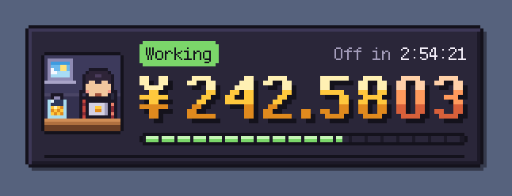
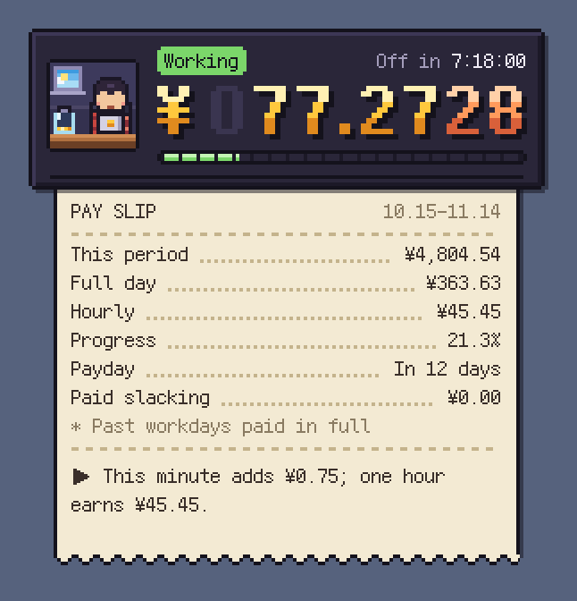
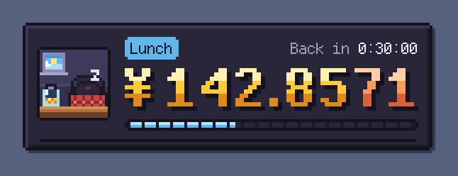
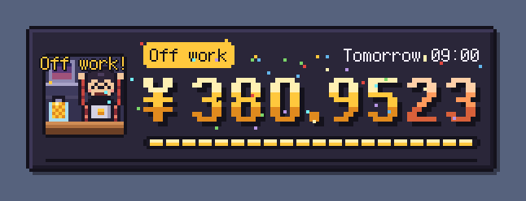
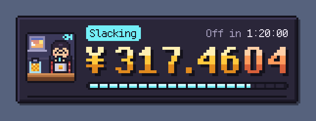
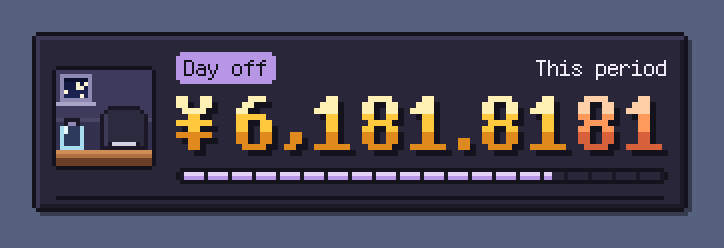
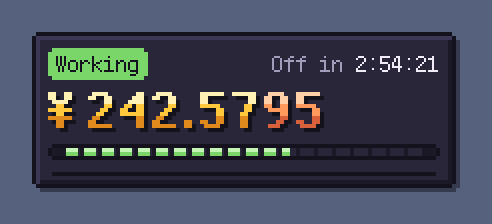
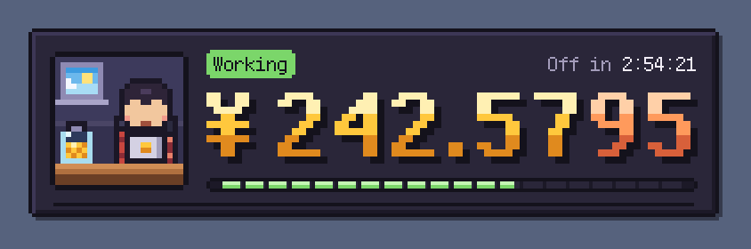

[简体中文](README.md) | English

# Work Motivator · Pixel Floating Widget (macOS)

A pixel-art floating widget for your desktop. Enter your salary and working hours, and it shows how much you have earned today, rolling the digits upward in real time.



## Features

- **Real-time earnings counter**: Pixel digits styled like a mechanical odometer. The lowest digit spins rapidly while higher digits carry over one by one. Higher digits you have not earned yet appear as dim zeros, and the third and subsequent decimal places are shown in copper.
- **A tiny pixel office**: A worker types away behind a laptop. As your earnings accumulate, coins fly into the piggy bank in the lower-left corner. Coin denominations are selected automatically, with at least 10 seconds between drops. The bank gradually fills as your workday progresses, and the sky outside changes with the actual time. During lunch, the worker naps at the desk; when work ends, confetti flies.
- **Click to print a pay slip**: A receipt emerges from the paper slot at the bottom of the widget, showing this period's earnings (counted from your last payday if one is set), a full day's pay, hourly pay, today's progress, days until payday, and earnings during paid slacking time. It also includes context-aware tips such as “Work for another 2 hours and 53 minutes to earn a T-shirt (¥99).”
- **Menu-bar coin**: Choose to show today's earnings, this period's earnings, or a countdown to the end of work in the menu bar.
- **Paid slacking timer**, **click-through lock**, **three sizes**, **adjustable opacity**, **launch at login**, and an **8-bit coin sound** (off by default).
- **Chinese and English UI**: Choose 简体中文 or English under “Settings › Display › Language”. Saving switches the menus, widget, pay slip, and tips together.
- Always on top and visible across all desktops and full-screen apps. Clicking it does not steal focus from the current app. It works entirely offline, and all data stays on your Mac.

| Pay slip | Lunch break | End of work |
|---|---|---|
|  |  |  |

| Paid slacking | Day off (period earnings) | Menu bar |
|---|---|---|
|  |  |  |

Three sizes are available: the small size keeps only the counter, while the large size shows the tiny office more clearly.

 

## Installation

1. Open `build/上班激励器.dmg` and drag “上班激励器” into “Applications”.
2. The settings window opens on first launch. Enter your salary and working hours, then click “保存并开始计时” (Save and start counting).
3. To use English, choose “English” under “显示 › 语言” (Display › Language) and save. The menus, widget, pay slip, and tips will all switch to English.

A locally built version opens directly. If you share the DMG with someone else, macOS may say that the developer cannot be verified on first launch. Right-click the app and choose “Open”. The app uses ad-hoc signing and has not been notarized by Apple.

## Usage

| Action | Result |
|---|---|
| Drag the widget | Move it anywhere; its position is restored on the next launch |
| Single-click | Expand or collapse the pay slip |
| Right-click (or Control + click) | Open the menu: pay slip, paid slacking, hide, lock, size, opacity, settings, launch at login, and quit |
| Click the menu-bar coin | Open the same menu; use this to find the widget after it is locked or hidden |

**Lock (click-through)**: When locked, the widget ignores mouse input and clicks pass through to the window underneath, making it ideal for a corner of your editor. A small lock appears in the upper-right corner. Use the menu-bar icon to unlock it.

## Calculation Rules

- **Daily pay**: Monthly salary ÷ actual working days in the current pay period. You can use 21.75 days or a custom number instead. If you are paid by the day or hour, choose Daily or Hourly. The settings window shows how your daily pay is calculated as you type.
- **Pay per second**: Daily pay ÷ paid seconds per day. Lunch is unpaid by default, but this can be changed.
- **Today's earnings**: Zero before work, accumulated by the second during work, paused during lunch, and equal to a full day's pay after work.
- **This period's earnings**: With a payday set, counting starts on your last payday (inclusive). For example, with payday on the 15th, November 3 counts from October 15. Without a payday, the period is the calendar month. Completed working days count as full days, plus today's earnings.
- **All amounts are rounded down**: The counter never displays money you have not earned yet.
- Selected weekdays determine days off. Public-holiday adjustments and overnight shifts spanning midnight are not currently supported.

See [docs/计算规则.md](docs/计算规则.md) for the complete rules and edge cases (in Chinese).

## Development

The only requirement is `swiftc`, included with Xcode. There are no third-party library dependencies.

```bash
./macos/build.sh test   # Run the calculation-core tests (17 groups)
./macos/build.sh        # Build for the current architecture → build/上班激励器.app
./macos/build.sh run    # Build and launch
./macos/build.sh dmg    # Test + universal build (Apple Silicon + Intel) + build/上班激励器.dmg
./macos/screenshots.sh  # Regenerate the English README screenshots
```

Ad-hoc signing is used by default. To sign with a certificate, place its name or SHA-1 in a `.codesign-identity` file at the repository root; this file is already listed in `.gitignore`.

### Project Structure

```
macos/
  Sources/
    PayCore.swift           Calculation core (pure Foundation; designed for Windows porting)
    Localization.swift      Language preference and bilingual text helper
    PixelKit.swift          Palette, pixel bitmaps, cut-corner borders, pixel font, bold digit glyphs
    Odometer.swift          Mechanical-odometer earnings display
    Diorama.swift           24×24 pixel office (sky, worker, piggy bank)
    WidgetView.swift        Widget rendering, mouse interactions, pay slip
    WidgetController.swift  Widget panel, timing loop, animations, slacking timer, window position
    SettingsWindow.swift    Native settings window
    AppDelegate.swift       Menu bar, menus, launch at login, debug arguments
    Store.swift / Sound.swift / main.swift
  Tests/main.swift          Calculation-core tests
  Resources/                Info.plist and pixel fonts
  tools/make-icon.swift     App icon generator
docs/                       Calculation rules, Windows porting guide, screenshots
```

### Debug Arguments

Screenshot and debug modes use in-memory settings only; they do not read or overwrite your own configuration.

```bash
BIN="build/上班激励器.app/Contents/MacOS/PixelWorkMotivator"
"$BIN" --snapshot out.png --now 2026-11-03T15:05:39 --settings '{"salary":8000,"payday":15}'
#   --expanded (expand pay slip) --size small|medium|large  --fishing 25 (25 minutes of slacking)
#   --celebrate (end-of-work confetti) --coin (drop a coin) --anim 0.7 (advance animation by 0.7s) --no-bg
"$BIN" --settings-snapshot settings.png      # Settings window
"$BIN" --menubar-snapshot menubar.png --settings '{"salary":8000}'
"$BIN" --print --settings '{"salary":8000}'  # Print menu-bar text and tips
"$BIN" --settings '{"salary":8000}' --now 2026-11-03T17:59:50 --speed 10   # Try it: see the celebration after 10 seconds
```

### Performance

Only the amount area is refreshed independently, and the entire widget is redrawn at most 8 times per second. With four decimal places, fast mode runs at 20 fps and uses approximately 3.5% CPU and 16 MB of memory (measured on Apple Silicon). To reduce power use, switch to two decimal places: the digits then change fewer than twice per second, and the frame rate automatically drops to 8 fps.

### Data

Settings and widget position are stored in UserDefaults under `local.pixel-work-motivator`. To remove everything, run `defaults delete local.pixel-work-motivator`.

## Windows Version

A native C# + WPF shell is planned. The calculation core will be ported from `PayCore.swift`, while the pixel glyphs, sprites, and palette can be reused. See [docs/windows.md](docs/windows.md) for the mapping and porting steps (in Chinese).

## Acknowledgments

- Pixel font: [Fusion Pixel Font](https://github.com/TakWolf/fusion-pixel-font) by TakWolf, licensed under SIL OFL 1.1. License files are included in `macos/Resources/Fonts/`.
- The layout was inspired by a Windows work-motivation widget; all pixel art, animations, and code were created from scratch.

## License

This project is open source under the [MIT License](LICENSE). The bundled pixel fonts use the SIL Open Font License 1.1; see the license files in `macos/Resources/Fonts/` for details.
