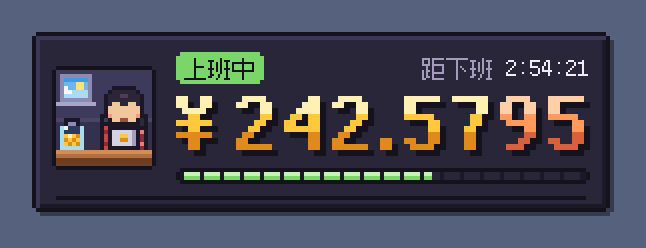
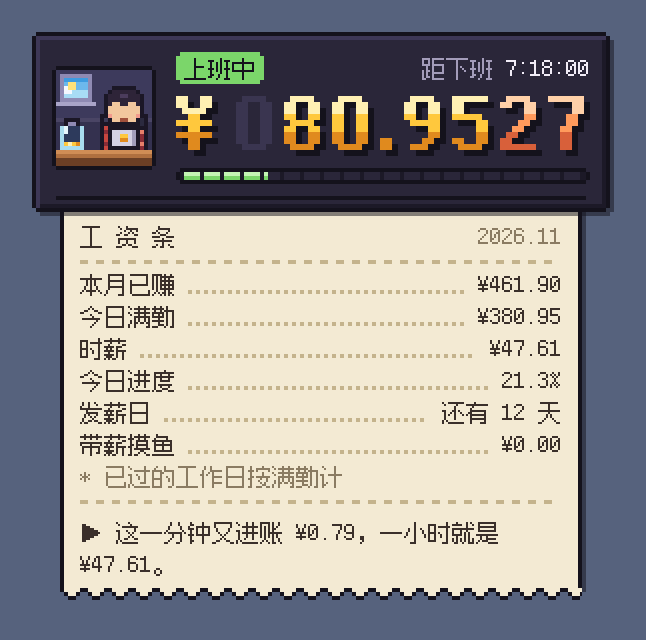
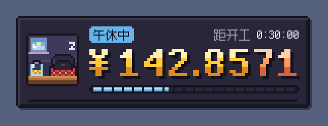
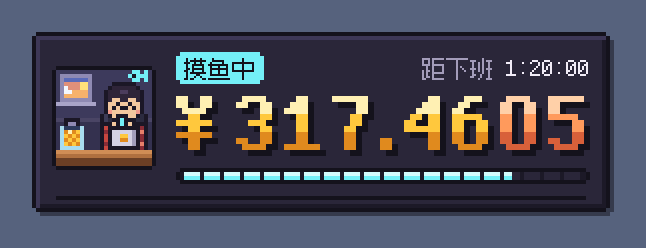
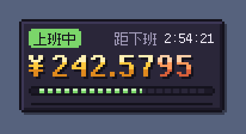
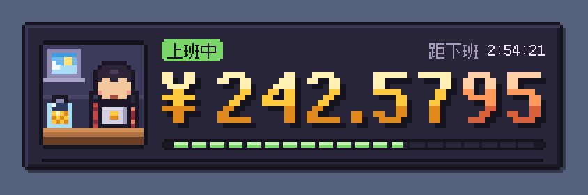

# 上班激励器 · 像素悬浮窗（macOS）

桌面上的一个像素风小悬浮窗。填好工资和上下班时间，它就把「今天已经赚了多少」一格一格地实时滚给你看。



## 它会做什么

- **实时滚动的工资**：机械里程表式的像素数字，最低位飞快地转，高位逐位进位；还没赚到的高位是暗色的 0，第 3 位以后的小数换成铜色。
- **像素小办公室**：打工人坐在笔记本后面敲键盘。每进账一笔，就有一枚金币飞进左下角的存钱罐，面额自动挑，至少隔 10 秒掉一枚。罐子跟着今日进度慢慢装满，窗外天色跟着真实时间变。午休时趴桌打呼，下班那一刻撒彩纸欢呼。
- **单击拉出工资条**：从悬浮窗底部的出纸口「打印」出来，列着本月已赚、今日满勤、时薪、今日进度、发薪日倒数、带薪摸鱼金额，外加一句会算账的提示，比如「再工作 2 小时 53 分，就能赚到一件 T 恤（¥99）」。
- **菜单栏金币**：菜单栏上实时显示今日已赚、本月已赚或下班倒计时，可以选。
- **带薪摸鱼计时**、**锁定后鼠标穿透**、**三档大小**、**不透明度**、**开机自启**、**8-bit 金币音**（默认关）。
- 总在最前，所有桌面和全屏应用上都看得到；点它不会抢走你当前应用的焦点。不联网，数据只存在本机。

| 拉出工资条 | 午休 | 下班那一刻 |
|---|---|---|
|  |  |  |

| 带薪摸鱼 | 休息日（显示本月已赚） | 菜单栏 |
|---|---|---|
|  |  |  |

三档大小：小号只留数字，大号的小办公室更清楚。

 

## 安装

1. 打开 `build/上班激励器.dmg`，把「上班激励器」拖进「应用程序」。
2. 第一次打开会弹出设置窗口：填工资和上下班时间，点「保存并开始计时」。

自己编译的版本直接能打开。如果把 dmg 发给同事，对方第一次打开会提示「无法验证开发者」，右键 App 选「打开」就行（这是 ad-hoc 签名，没有经过 Apple 公证）。

## 怎么用

| 操作 | 效果 |
|---|---|
| 拖动悬浮窗 | 搬到任意位置，下次启动还在那 |
| 单击 | 拉出 / 收起工资条 |
| 右键（或 Control + 单击） | 菜单：工资条、带薪摸鱼、隐藏、锁定、大小、不透明度、设置、开机自启、退出 |
| 菜单栏的金币 | 同一份菜单。悬浮窗被锁定或隐藏后，从这里找回来 |

**锁定（鼠标穿透）**：锁定后悬浮窗不再响应鼠标，点击会直接落到下面的窗口上，适合把它放在编辑器角落。右上角会出现一把小锁，解锁要到菜单栏操作。

## 计算规则

- **日薪**：月薪 ÷ 当月实际工作日（可改成 21.75 天或自定义天数）。也可以直接填日薪或时薪。
- **每秒工资**：日薪 ÷ 每天计薪的秒数。午休默认不计薪，可以关掉。
- **今日已赚**：上班前是 0，上班中按秒累计，午休时停住，下班后等于日薪。
- **本月已赚**：本月已经过去的工作日按满勤算，再加上今天已赚。
- **金额一律向下取整**：计数器永远不显示还没挣到的钱。
- 休息日由「工作日」勾选决定，暂不支持法定节假日调休和跨零点的夜班。

完整规则和边界情况见 [docs/计算规则.md](docs/计算规则.md)。

## 开发

只依赖 Xcode 自带的 `swiftc`，没有第三方库。

```bash
./macos/build.sh test   # 跑计算核心测试（13 组）
./macos/build.sh        # 编译当前架构 → build/上班激励器.app
./macos/build.sh run    # 编译并启动
./macos/build.sh dmg    # 测试 + 通用版（Apple 芯片 + Intel）+ build/上班激励器.dmg
```

签名默认 ad-hoc。仓库根目录放一个 `.codesign-identity`（已加进 .gitignore），写上证书名或 SHA-1，就改用该证书签名。

### 目录

```
macos/
  Sources/
    PayCore.swift           计算核心（纯 Foundation，Windows 版照着移植）
    PixelKit.swift          调色板、像素位图、缺角边框、像素字体、粗体数字字形
    Odometer.swift          机械里程表式滚轮金额
    Diorama.swift           24×24 像素小办公室（天色、打工人、存钱罐）
    WidgetView.swift        悬浮窗绘制与鼠标交互、工资条
    WidgetController.swift  悬浮窗面板、计时循环、动画、摸鱼计时、窗口位置
    SettingsWindow.swift    原生设置窗口
    AppDelegate.swift       菜单栏、菜单、开机自启、调试参数
    Store.swift / Sound.swift / main.swift
  Tests/main.swift          计算核心测试
  Resources/                Info.plist、像素字体
  tools/make-icon.swift     生成应用图标
docs/                       计算规则、Windows 移植说明、截图
```

### 调试参数

截图和调试模式只用内存里的设置，不会读写你自己的配置。

```bash
BIN="build/上班激励器.app/Contents/MacOS/PixelWorkMotivator"
"$BIN" --snapshot out.png --now 2026-11-03T15:05:39 --settings '{"salary":8000,"payday":15}'
#   --expanded（拉出工资条） --size small|medium|large  --fishing 25（摸了 25 分钟）
#   --celebrate（下班彩纸） --coin（飞一枚金币） --anim 0.7（动画先走 0.7 秒） --no-bg
"$BIN" --settings-snapshot settings.png      # 设置窗口
"$BIN" --menubar-snapshot menubar.png --settings '{"salary":8000}'
"$BIN" --print --settings '{"salary":8000}'  # 打印菜单栏文字和提示
"$BIN" --settings '{"salary":8000}' --now 2026-11-03T17:59:50 --speed 10   # 试跑：10 秒后看下班庆祝
```

### 性能

金额区域单独刷新，整窗每秒最多重画 8 次。4 位小数时快速档 20fps，CPU 约 3.5%，内存约 16MB（M 系列芯片实测）。想更省电，可以把小数位调到 2：数字每秒变不到两次，会自动降到 8fps。

### 数据

设置和悬浮窗位置存在 UserDefaults（域 `local.pixel-work-motivator`）。全部清掉：`defaults delete local.pixel-work-motivator`。

## Windows 版

计划用 C# + WPF 写一个原生壳，照着 `PayCore.swift` 移植计算核心，像素字形、精灵图和调色板原样搬过去。对照表和步骤见 [docs/windows.md](docs/windows.md)。

## 致谢

- 像素字体：[缝合像素字体 Fusion Pixel Font](https://github.com/TakWolf/fusion-pixel-font)（TakWolf，SIL OFL 1.1），许可证见 `macos/Resources/Fonts/`。
- 版式参考了一款 Windows 上的「上班鼓励器」，像素画、动画和代码都是新写的。

## 开源许可证

本项目基于 [MIT License](LICENSE) 开源。随附的像素字体使用 SIL Open Font License 1.1，详见 `macos/Resources/Fonts/` 中的许可证文件。
